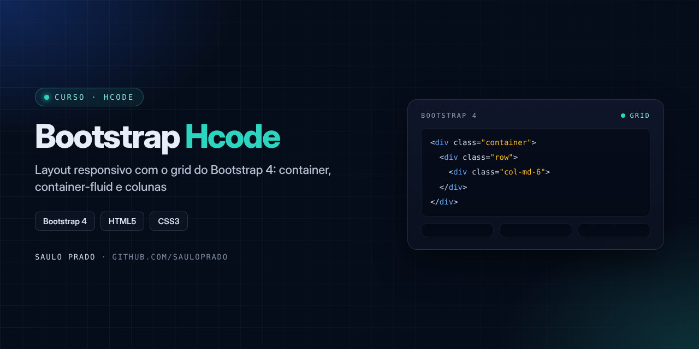

<p align="center">

</p>

<h1 align="center">Bootstrap — Hcode</h1>
<p align="center"><i>Layout responsivo com o sistema de grid do Bootstrap 4</i></p>

<p align="center">


</p>

## Sumário

- [Sobre](#sobre)
- [O que foi praticado](#o-que-foi-praticado)
- [Como visualizar](#como-visualizar)
- [Estrutura do repositório](#estrutura-do-repositório)
- [Autor](#autor)

## Sobre

Exercícios do **curso de Bootstrap da Hcode**, praticando a base do framework: containers, linhas e colunas para montar layouts responsivos. O Bootstrap **4.3.1** está incluído localmente (`css/` e `js/`), então os exemplos funcionam sem internet.

## O que foi praticado

| Arquivo | Conceito |
| --- | --- |
| `index.html` | Página base com o Bootstrap carregado |
| `container.html` | Container de largura fixa e responsiva |
| `container-fluid.html` | Container de largura total |
| `css/` · `js/` | Bootstrap 4.3.1, jQuery 3.5.1 e Popper locais |

## Como visualizar

Clone o repositório e abra os arquivos `.html` no navegador:

```bash
git clone https://github.com/sauloprado/Curso-Hcode-Bootstrap.git
```

## Estrutura do repositório

```text
Curso-Hcode-Bootstrap/
├── css/          # Bootstrap 4.3.1
├── js/           # Bootstrap, jQuery e Popper
├── index.html
├── container.html
├── container-fluid.html
└── assets/capa.png
```

## Autor

**Saulo Prado** · Analista de Sistemas · Gestão de Ativos de TI, orçamento, automação e dashboards

[](https://www.linkedin.com/in/saulo-prado-ab4a0b96/)
[](https://github.com/sauloprado)
